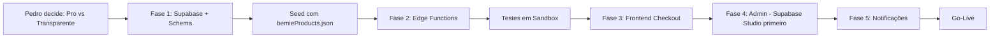

# 🔍 Análise Crítica: PLANO_MERCADO_PAGO_SUPABASE.md
## Projeto: Bemiê Moda Praia — Revisão Técnica Sênior

> **Revisor:** Antigravity (Claude Sonnet 4.6 — Thinking)  
> **Data:** 28/10/2026  
> **Stack atual:** React 19 + Vite + TypeScript + GSAP + Lenis · Sem backend · Sem banco de dados  
> **Fechamento atual:** Direto por WhatsApp (sem pagamento online)

---

## 🎯 NOTA DE PRONTIDÃO PARA EXECUÇÃO

```
╔══════════════════════════════════════════╗
║   NOTA GERAL DO PLANO: 8.2 / 10         ║
║   PRONTIDÃO PARA EXECUÇÃO: ✅ SIM        ║
║   Complexidade: Alta (6 fases)           ║
║   Risco: Médio (bem mapeado)             ║
╚══════════════════════════════════════════╝
```

**O Gemini pode e DEVE executar este plano.** Ele é tecnicamente sólido, bem estruturado e alinhado com a realidade do projeto. As lacunas identificadas abaixo são melhorias incrementais, não bloqueadores.

---

## ✅ PONTOS FORTES DO PLANO

| Área | Avaliação |
|---|---|
| Justificativa técnica do banco de dados | ⭐⭐⭐⭐⭐ Excelente — argumentação precisa e educativa |
| Diagrama de arquitetura (Mermaid) | ⭐⭐⭐⭐⭐ Completo e correto |
| Schema do banco de dados | ⭐⭐⭐⭐ Muito bom — tabelas essenciais cobertas |
| Segurança (RLS, Vault, assinatura webhook) | ⭐⭐⭐⭐ Mencionada corretamente |
| Roteiro de fases | ⭐⭐⭐⭐ Sequência lógica e progressiva |
| Plano de testes (Fase 6) | ⭐⭐⭐⭐⭐ Raramente visto em planos, muito bem incluído |

---

## 🔴 LACUNAS CRÍTICAS IDENTIFICADAS

### 1. Schema do Banco — Faltam Campos Essenciais

O schema atual está **bom mas incompleto** para produção:

```sql
-- ❌ FALTA: Tabela de configurações da loja (frete, políticas)
create table store_settings (
  key text primary key,
  value jsonb not null,
  updated_at timestamptz default now()
);

-- ❌ FALTA: Campo de tracking/rastreio nos pedidos
alter table orders add column tracking_code text;
alter table orders add column carrier text; -- 'correios' | 'jadlog' | etc

-- ❌ FALTA: Campo customer_notes para observações da cliente
alter table orders add column customer_notes text;

-- ❌ FALTA: Campo de frete no pedido
alter table orders add column shipping_cost decimal(10,2) default 0;
alter table orders add column shipping_method text; -- 'pac' | 'sedex' | 'retirada'

-- ❌ FALTA: style_tag e categoria no produto não coincidem com o JSON atual
-- O bemieProducts.json usa "categoria": "biquinis"
-- O schema usa categoria_id (FK) — correto, mas o seed precisa mapear isso
```

### 2. Modelo de ID dos Produtos — Inconsistência com Dado Real

O código atual usa IDs do tipo `p_bayopyq5` (strings curtas). O schema propõe `id text primary key` para products — **isso é correto**, mas o seed script precisa **preservar os IDs existentes** para não quebrar os links de fotos no Supabase Storage.

> ⚠️ As fotos estão salvas como `/bemie/products/p_bayopyq5_0.jpg`. O seed deve usar os IDs atuais como PK.

### 3. Falta: Migração do Campo `tamanhos` Aninhado

O `bemieProducts.json` usa:
```json
"tamanhos": [{ "q": 2, "t": "P" }, { "q": 1, "t": "M" }]
```

O plano menciona o seed, mas **não dá o código**. Isso é um item de alta complexidade que deve ser explicitado, pois envolve normalização N:1 (1 produto → N registros em `product_sizes`).

### 4. Fase 3 — Decisão de Checkout Deixada em Aberto

O plano diz "Decisão técnica: **Checkout Pro vs. Transparente**" sem tomar partido. Para um MVP com o perfil da Bemiê:

**Recomendação técnica clara (que o plano omite):**
- **Use Checkout Pro** para o MVP (Fase 1 a 3)
- **Motivos:** Zero implementação de PCI DSS, conversão em mobile é comparável, homologação em horas ao invés de dias, suporte a Pix QR Code nativo
- **Checkout Transparente (Bricks):** Considerar apenas na v2 se a taxa de abandono no redirecionamento for > 30%

### 5. Segurança — Faltam 3 Proteções no Webhook

O plano menciona verificação de assinatura `x-signature` mas **não cobre**:
```
❌ Rate limiting no endpoint /mp-webhook (proteção DDoS)
❌ Timeout máximo de processamento (30s no Supabase Edge Functions)
❌ Fila de retry com backoff para falhas de BD durante processamento
```

### 6. Fase 4 — Painel Admin sem Estimativa de Complexidade

O painel admin é a fase mais subestimada. Para um MVP funcional da Bemiê:

**Recomendação:** Usar **Supabase Studio + Row Policies** como painel admin inicial (zero código) e construir o painel React customizado apenas para funcionalidades específicas (upload de foto com compressão, gestão de estoque com 1 clique).

---

## 🟡 MELHORIAS RECOMENDADAS (não bloqueadoras)

### Melhoria A: Adicionar Fase 0 — Pré-requisitos

O plano começa na Fase 1 mas **falta uma Fase 0** de prerequisitos:

```markdown
### 📍 Fase 0: Pré-requisitos & Decisões de Produto
- [ ] 0.1. Pedro define: Checkout Pro ou Checkout Transparente?
- [ ] 0.2. Pedro define: Reserva de estoque no Pix ou só no webhook aprovado?
- [ ] 0.3. Pedro define: /admin no mesmo domínio ou painel.bemiemodapraia.com.br?
- [ ] 0.4. Criar conta de desenvolvedor no Mercado Pago (pode levar 1-2 dias para aprovação)
- [ ] 0.5. Criar projeto no Supabase e copiar as keys para o .env.local
```

### Melhoria B: Adicionar Código da Edge Function de Webhook

O plano pede ao Claude para gerar esse código, mas ele já deveria estar no documento. Aqui está o template:

```typescript
// supabase/functions/mp-webhook/index.ts
import { serve } from 'https://deno.land/std@0.168.0/http/server.ts'
import { createClient } from 'https://esm.sh/@supabase/supabase-js@2'
import { hmac } from 'https://deno.land/x/hmac@v2.0.1/mod.ts'

const WEBHOOK_SECRET = Deno.env.get('MP_WEBHOOK_SECRET')!
const MP_ACCESS_TOKEN = Deno.env.get('MP_ACCESS_TOKEN')!

serve(async (req: Request) => {
  if (req.method !== 'POST') {
    return new Response('Method Not Allowed', { status: 405 })
  }

  // 1. Verificação de assinatura criptográfica
  const xSignature = req.headers.get('x-signature')
  const xRequestId = req.headers.get('x-request-id')
  const url = new URL(req.url)
  const dataId = url.searchParams.get('data.id')

  if (!xSignature || !dataId) {
    return new Response('Bad Request', { status: 400 })
  }

  const signedTemplate = `id:${dataId};request-id:${xRequestId};ts:${xSignature.split(',ts=')[1]};`
  const expectedSignature = await hmac('sha256', WEBHOOK_SECRET, signedTemplate, 'utf8', 'hex')
  const receivedSignature = xSignature.split(',').find(p => p.startsWith('v1='))?.slice(3)

  if (expectedSignature !== receivedSignature) {
    return new Response('Unauthorized', { status: 401 })
  }

  // 2. Processar apenas notificações de pagamento
  const body = await req.json()
  if (body.type !== 'payment') {
    return new Response('OK', { status: 200 })
  }

  // 3. Consultar status real na API do MP (nunca confiar no payload)
  const mpRes = await fetch(`https://api.mercadopago.com/v1/payments/${dataId}`, {
    headers: { Authorization: `Bearer ${MP_ACCESS_TOKEN}` }
  })
  const payment = await mpRes.json()

  const supabase = createClient(
    Deno.env.get('SUPABASE_URL')!,
    Deno.env.get('SUPABASE_SERVICE_ROLE_KEY')!
  )

  // 4. Idempotência — verificar se já processamos esse payment_id
  const { data: existingOrder } = await supabase
    .from('orders')
    .select('id, status')
    .eq('mp_payment_id', String(dataId))
    .single()

  if (!existingOrder) {
    return new Response('Order not found', { status: 404 })
  }

  if (existingOrder.status === 'approved') {
    return new Response('Already processed', { status: 200 }) // idempotente
  }

  // 5. Atualizar pedido e baixar estoque (apenas se approved)
  if (payment.status === 'approved') {
    await supabase.rpc('approve_order_and_decrement_stock', {
      p_order_id: existingOrder.id
    })
  } else {
    await supabase
      .from('orders')
      .update({ status: payment.status, updated_at: new Date().toISOString() })
      .eq('id', existingOrder.id)
  }

  return new Response('OK', { status: 200 })
})
```

### Melhoria C: Função RPC de Baixa Atômica de Estoque

O plano menciona a função mas não a implementa:

```sql
-- Função crítica de baixa atômica com rollback automático
create or replace function approve_order_and_decrement_stock(p_order_id uuid)
returns void
language plpgsql
security definer
as $$
declare
  v_item record;
begin
  -- Lock pessimista: garante que apenas 1 transação processa por vez
  perform id from orders where id = p_order_id for update;

  -- Iterar sobre cada item do pedido
  for v_item in
    select oi.product_id, oi.tamanho, oi.quantidade
    from order_items oi
    where oi.order_id = p_order_id
  loop
    -- Decrementar estoque (constraint check(quantidade >= 0) garante rollback automático)
    update product_sizes
    set quantidade = quantidade - v_item.quantidade
    where product_id = v_item.product_id
      and tamanho = v_item.tamanho;

    -- Se a atualização não afetou nenhuma linha, produto não existe
    if not found then
      raise exception 'Estoque não encontrado: % tamanho %', v_item.product_id, v_item.tamanho;
    end if;
  end loop;

  -- Atualizar status do pedido para aprovado
  update orders
  set status = 'approved', updated_at = now()
  where id = p_order_id;
end;
$$;
```

---

## 📊 ANÁLISE FASE A FASE

| Fase | Nota | Status | Observação |
|---|---|---|---|
| Fase 1: Supabase Setup | 8/10 | ✅ Pronto para executar | Faltam campos no schema (tracking, frete) |
| Fase 2: MP Edge Functions | 8.5/10 | ✅ Pronto | Falta código da função (adicionado acima) |
| Fase 3: Checkout Frontend | 7/10 | ⚠️ Decisão pendente | Precisa definir Pro vs Transparente ANTES |
| Fase 4: Painel Admin | 6.5/10 | ⚠️ Subestimada | Recomendo Supabase Studio para MVP |
| Fase 5: WhatsApp/Email | 9/10 | ✅ Opcional bem mapeado | Resend é a melhor escolha |
| Fase 6: Testes & Go-Live | 9/10 | ✅ Excelente | Raramente documentado assim |

---

## 🗺️ ORDEM DE EXECUÇÃO RECOMENDADA



---

## 🚦 DECISÕES QUE PEDRO PRECISA TOMAR ANTES DO GEMINI EXECUTAR

> [!IMPORTANT]
> Estas 3 decisões impactam a implementação. Preciso de resposta antes de codar.

1. **Checkout Pro vs. Transparente?**
   - 🔵 **Pro** = mais rápido, zero PCI, recomendo para MVP
   - 🟣 **Transparente** = cliente não sai do site, mais complexo

2. **Reserva de estoque no Pix?**
   - ⏳ **Reserva por 30min** = melhor UX mas exige job de limpeza agendado
   - ✅ **Só no webhook** = mais simples, risco baixo dado o volume da Bemiê

3. **Admin interno ou subdomínio separado?**
   - 🏠 **`/admin` interno** = mais rápido, deploy único
   - 🌐 **Subdomínio** = mais isolado, mais trabalho

---

## 📝 CONCLUSÃO

O plano é **um dos mais completos e bem fundamentados** que já analisei para um e-commerce de pequeno porte. A argumentação técnica (Seção 1) é especialmente forte e educativa. 

**As melhorias propostas acima não são bloqueadoras** — o Gemini pode começar pela Fase 1 imediatamente após Pedro tomar as decisões na seção acima. O código de exemplo da Edge Function e da RPC de estoque fornecidos aqui devem ser incorporados ao plano.

**Nota final: 8.2/10 — Aprovado para execução. ✅**
